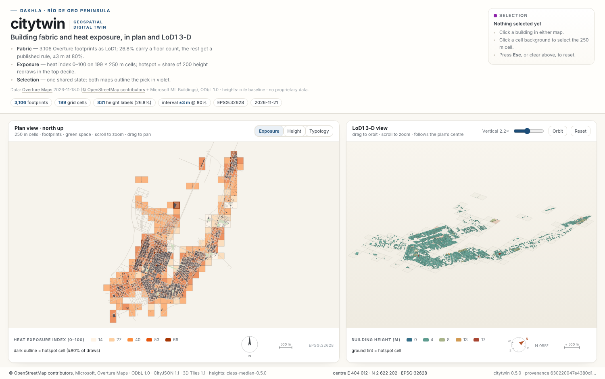
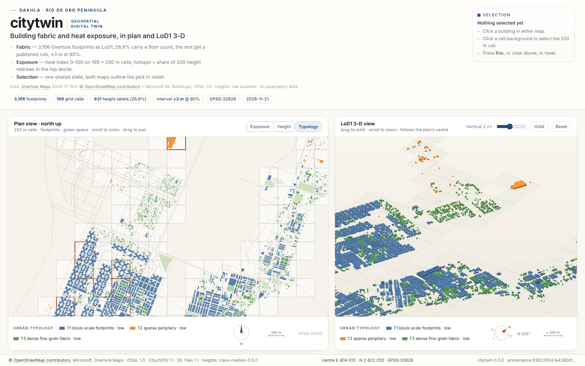
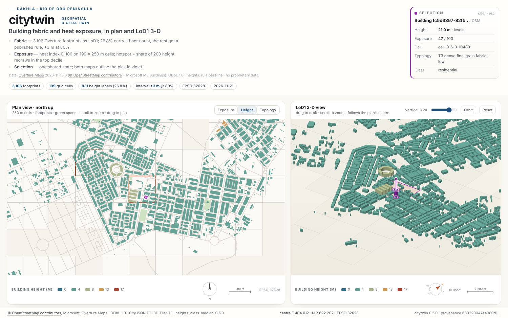
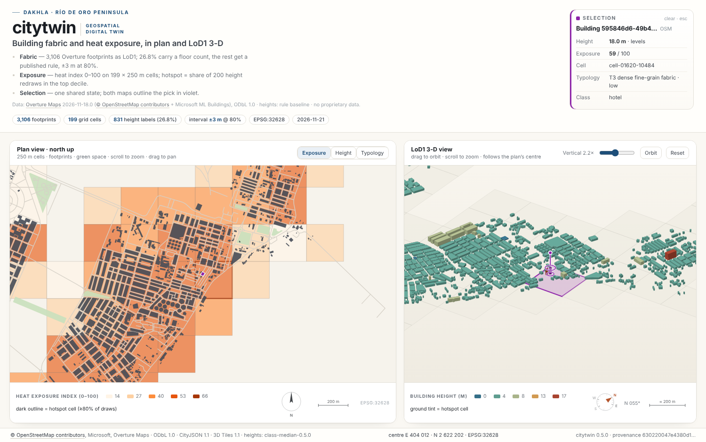
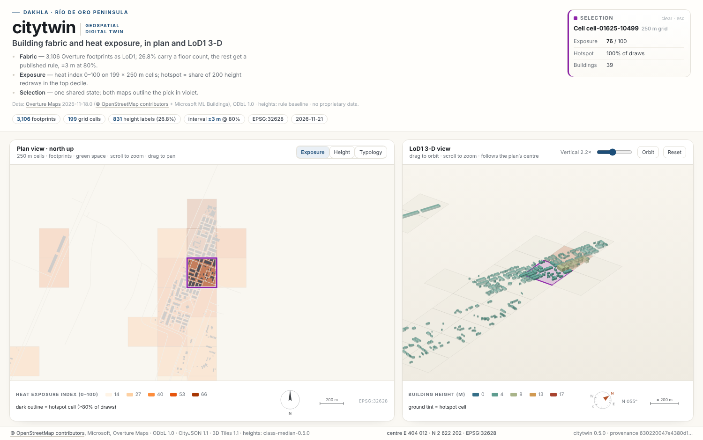

# citytwin · Dakhla

**An auditable geospatial digital twin of Dakhla — footprints in, standards out.**

**▶ Interactive viewer: [`index.html`](index.html)** — plan and LoD1 3-D side by side,
three colour modes, vertical exaggeration, linked selection. One self-contained file:
no CDN, no tiles, opens from `file://`.

This is a Dakhla build of [caoqyqianyi/citytwin](https://github.com/caoqyqianyi/citytwin)
(MIT, © 2026 Qianyi Cao), which was written for Esch-sur-Alzette in Luxembourg. The
pipeline, exporters, API, agent and viewer are that project's; what changed for Dakhla
is listed [below](#what-changed-from-the-upstream-project) and argued in
[ADR 0004](docs/adr/0004-dakhla-adaptation.md).

`citytwin` builds a LoD1 city model from open building footprints, completes missing
building heights with a calibrated rule, propagates that uncertainty into an urban
heat-exposure index, and publishes the result through CityJSON, 3D Tiles and an OGC API
Features service. A small tool-using agent answers questions about the twin by calling
audited queries — never by inventing numbers.

The study area is the **city of Dakhla** on the Río de Oro peninsula: a 5.0 km × 6.5 km
box, 3 106 footprints, a 250 m analysis grid in UTM zone 28N.

**Data source:** [Overture Maps](https://overturemaps.org/) release `2026-11-18.0`
(© OpenStreetMap contributors and Microsoft ML Buildings,
[ODbL 1.0](https://opendatacommons.org/licenses/odbl/1-0/)), read as a bbox-filtered
GeoParquet extract from the public S3 bucket. Missing heights are completed by the rule
baseline below, never by a proprietary dataset; there is no personal data in the
pipeline.



*The viewer: a north-up exposure plan beside an axonometric LoD1 model. The two panels
share one selection and one focus — click a footprint or a 250 m cell in either map and
the other highlights it; scroll to zoom, drag the plan to pan and the 3-D view follows.*

## Read this before the numbers

Dakhla is thinly mapped, and the twin says so instead of hiding it.

- **Heights are mostly assumed.** 831 of 3 106 footprints (26.8%) carry a height, all
  from OpenStreetMap floor counts, and 780 of those say exactly two storeys. The
  remaining 2 275 get 6 m ± 3 m. The height model's 0.36 m error measures how uniform
  the labels are, not how accurate the imputed heights are.
- **The exposure index is a relative score, not a temperature.** It ranks 250 m cells
  on built-up share, building height and (lack of) mapped vegetation. It does not see
  the sea breeze, which in Dakhla probably matters more than any of them.
- **Only 11 of the 20 hotspot cells are robust.** The other nine depend on the height
  guess. The viewer outlines only the robust ones.

## What it produces

| Output | Path | Size / content |
|---|---|---|
| Self-contained 2D/3D viewer | `index.html` | 1.4 MB, zero external requests |
| CityJSON 1.1 LoD1 model | `build/cityjson/dakhla_lod1.city.json` | 3 106 buildings, 0 open shells |
| 3D Tiles 1.1 tileset + GLB | `build/3dtiles/` | 52 848 triangles, 2.9 MB |
| OGC API Features | `citytwin serve` | collections `buildings`, `cells`, `green` |
| Feature store | `build/store/citytwin.sqlite` | SQLite + R\*Tree, no server needed |
| Provenance | `build/provenance.json` | PROV-JSON, re-hashable with `citytwin verify` |
| Model card & metrics | `docs/model_card.md`, `docs/metrics.json` | generated, not hand-written |
| Agent evaluation | `docs/agent_eval.md` | 12 golden questions, groundedness checks |

`build/` and `data/` are regenerated by `citytwin build` and are not committed.

Key numbers from the last run (all reproducible with `citytwin build`):

| Quantity | Value |
|---|---|
| Footprints | 3 106 — 1 923 Microsoft ML Buildings, 1 183 OpenStreetMap |
| Height labels | 831 (26.8%), 94% of them two storeys |
| Grid | 199 occupied cells of 250 m, 1 243.8 ha |
| Height completion | rule MAE 0.36 m, RMSE 1.59 m, R² −0.05; interval ±3.0 m (one-storey floor) |
| Learned benchmark (random forest) | identical scores — **not shipped**, the simpler rule is kept |
| Exposure index | mean 50.1, hotspot threshold 64.7, 20 hotspot cells (10% of area) |
| Typology | 3 morphology clusters, silhouette 0.249, stability ARI 0.974 |
| Hotspot stability under height uncertainty | Jaccard 0.50 (mean), 11 cells above p ≥ 0.8 |
| Weight sensitivity | Spearman ρ 0.938 median; top-decile Jaccard 0.60 median |
| Mapped vegetation | 19 polygons, 5 trees — 0.9% of the gridded area |

## What changed from the upstream project

| | Upstream (Esch-sur-Alzette) | Here (Dakhla) |
|---|---|---|
| Source | OSM API 0.6 XML | Overture Maps GeoParquet (OSM + Microsoft ML footprints) — `ingest/overture.py` |
| Feature id | `osm_id` | `gers_id` (Overture GERS), plus `footprint_source` |
| Metric CRS | EPSG:25832 | EPSG:32628 (UTM 28N) |
| Index weights | height 0.35 · built-up 0.15 | height 0.15 · built-up 0.35 (heights barely vary here) |
| Height interval | raw 80% conformal quantile | same, floored at one storey (the raw quantile is 0 m here) |
| Green | includes pitches, recreation grounds | excludes them (bare sand or artificial turf) |
| Typology | k = arg-max silhouette; fixed thresholds for labels | smallest k within 0.02 of the best; labels relative to the area mean |
| Viewer | fits the 1 km extent | shared focus, zoom to 12×, plan panning; `?zoom=` |
| Viewer path | `web/index.html` | `index.html` (served by this site at `/citytwin/`) |

Not carried over: the upstream GitHub Actions workflows (CI and Pages) and
`CITATION.cff`. Tests and lint run locally with `make test lint`.

## Quickstart

```bash
cd citytwin
python -m venv .venv && source .venv/bin/activate
pip install -e ".[dev]"

citytwin build          # full pipeline (~2 min; downloads one Overture extract, then cached)
citytwin verify         # re-hashes artefacts, checks CityJSON shells and the GLB
citytwin serve          # OGC API at http://127.0.0.1:8000/docs
citytwin agent "Which cells are robust hotspots at 80% probability?"
citytwin eval           # golden-question harness, writes docs/agent_eval.md
```

`make all` runs build → verify → eval → figures in one go. Everything after the first
`build` works offline. The Overture release is pinned in `src/citytwin/config.py`
(`CITYTWIN_OVERTURE_RELEASE` overrides it); `citytwin build --refresh` re-downloads.

Viewer URL parameters: `?mode=height` and `?mode=typology` switch the colouring,
`?exag=0.8…4` sets the vertical exaggeration, `?sel=<n>` and `?cell=<n>` open a
selection, `?zoom=0.65…12` zooms (onto the selection, if there is one), and `Esc`
clears. The viewer runs a small cartographic self-test at load (`east → right`,
`north → up`, in both projections) and exposes the result as
`<html data-cartography="ok">`, which `make figures` asserts before taking screenshots.

| Typology · three urban-form clusters | Height · 3.2× vertical, one footprint selected |
|:---:|:---:|
| [](docs/assets/typology_view.png) | [](docs/assets/height_view.png) |
| **Selection · one building, two views** | **Selection · one 250 m cell, two views** |
| [](docs/assets/selection_view.png) | [](docs/assets/cell_view.png) |

*Typology recolours every footprint by its cluster: block-scale footprints (mostly OSM
blocks), dense fine-grain fabric (mostly ML-detected single roofs) and sparse
periphery. Selection is one shared state: a building or a 250 m cell is outlined in the
plan, pinned in the 3-D view and described in the inspector.*

## Pipeline

```
Overture S3 ──► ingest ──► features ──► height completion ──► typology ──► exposure
                  │                        │                    │            │
      GeoJSON layers        intervals (≥ one storey)    KMeans + ARI    250 m grid, HEI
                  │                        │                    │            │
                  └────────────► feature store (SQLite + R*Tree) ◄───────────┘
                                           │
              CityJSON 1.1 · 3D Tiles 1.1 · OGC API Features · viewer · PROV-JSON
```

The Heat Exposure Index is a weighted sum of four percentile-ranked components per
cell — built-up share 0.35, lack of green 0.30, distance to green 0.20, building height
0.15 (`configs/exposure_weights.json`) — so every score can be decomposed and
re-weighted.

## Documentation

- [`docs/architecture.md`](docs/architecture.md) — modules, data flow, failure modes
- [`docs/uncertainty.md`](docs/uncertainty.md) — from missing heights to hotspot stability
- [`docs/model_card.md`](docs/model_card.md) — height completion, generated by the build
- [`docs/standards.md`](docs/standards.md) — what is implemented, and what is not
- [`docs/agent_eval.md`](docs/agent_eval.md) — the agent's golden questions
- [`docs/adr/`](docs/adr) — decisions, including the [Dakhla adaptation](docs/adr/0004-dakhla-adaptation.md)

## What would make it better

1. Measured building heights (a DSM from drone photogrammetry or stereo satellite).
2. A satellite land-surface-temperature layer to validate the index against, and a
   coast-distance or wind-exposure component.
3. A vegetation canopy layer from imagery instead of mapped parks.

## Licence

Code: MIT, © 2026 Qianyi Cao (upstream), with the Dakhla changes under the same
licence — see [`LICENSE`](LICENSE). Data: ODbL 1.0, © OpenStreetMap contributors,
Microsoft, Overture Maps Foundation.
