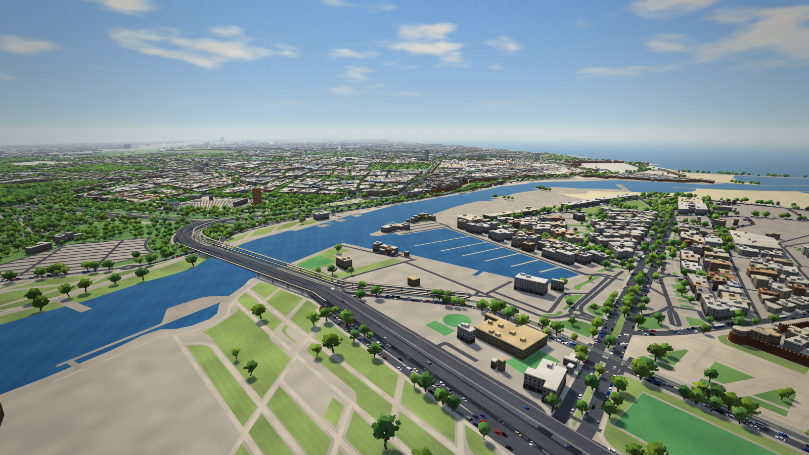
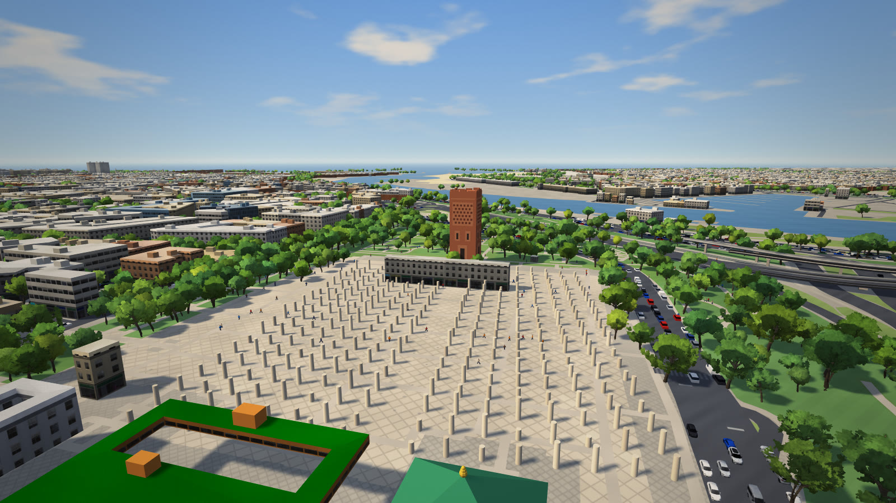
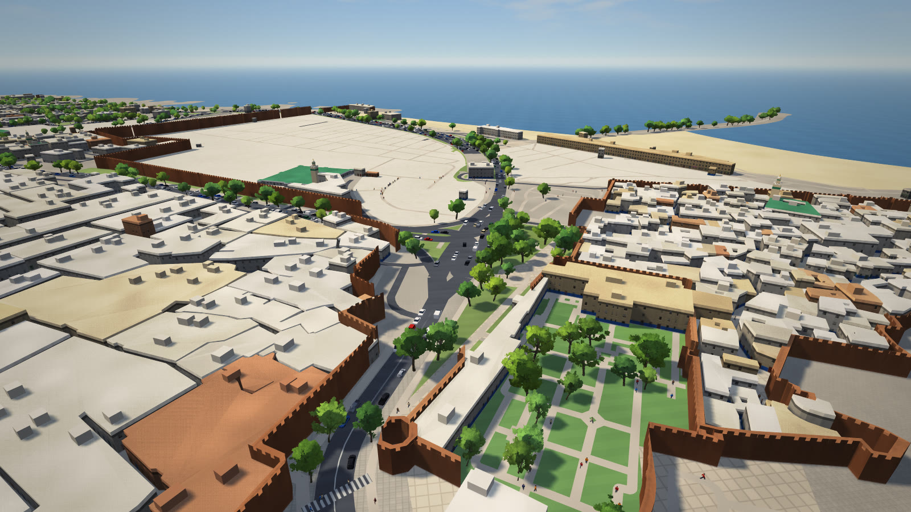
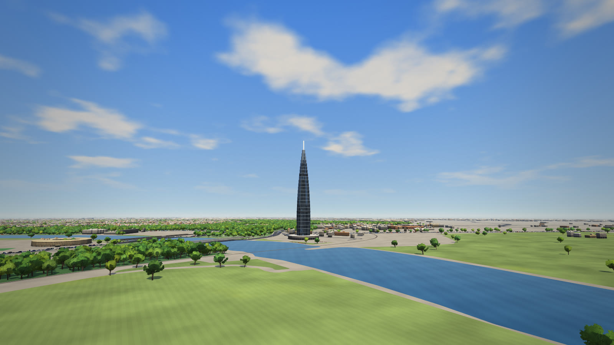
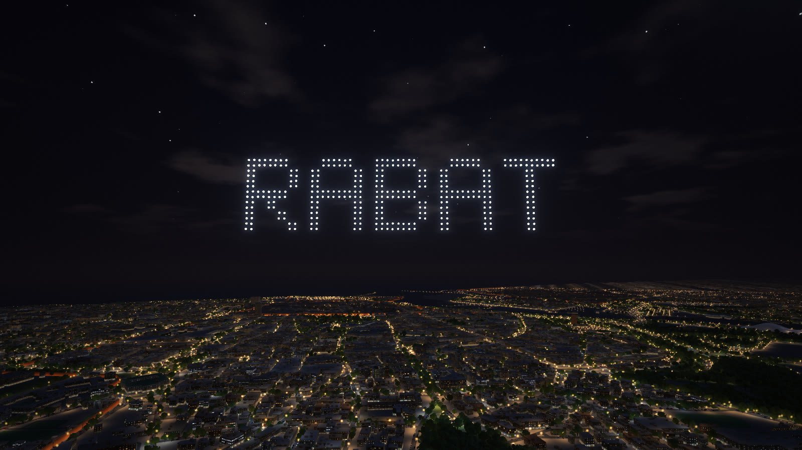

# Rabat free roam · الرباط

An open Rabat that runs in the browser: fly over it, land and walk its streets, get into a car and
drive. Real building footprints and streets, the two medinas, the Kasbah of the Udayas behind its
ramparts, the Hassan Tower and its field of columns, the Bouregreg and the Atlantic, by day and by night.

**▶ [Open it](index.html)** (a desktop browser with a keyboard and mouse; Chrome works best).



| The Hassan Tower and the unfinished mosque | The medina inside its walls |
|---|---|
|  |  |

| The Mohammed VI Tower | Night, and the light show |
|---|---|
|  |  |

It is the Rabat counterpart of [manhattan-free-roam](https://github.com/huangserva/manhattan-free-roam)
by huangserva: the same engine (its Three.js source, MIT licensed, ported file by file) on a different
city and a different data source. Like the original it is a place to roam, not a game: there are no
missions, and detail up close is limited.

## What is in it

- **The real city**: 20,566 building pieces, 11,776 road segments, 34,640 trees, 171 pieces of rampart,
  42 mosques with their minarets, the tram's track bed, 510 named places to search for. A 6.4 × 5.3 km
  box from Agdal to the Salé medina and from the ocean to the Mohammed VI Tower.
- **Three ways to move**: flying, walking (first or third person), driving any parked car. Traffic and
  passers-by fill the streets around you. Rabat's petits taxis are blue.
- **Five monuments built by hand in code** (`src/landmarks.js`): the Hassan Tower with the columns of its
  unfinished prayer hall, the Mausoleum of Mohammed V, the Mohammed VI Tower, the Grand Théâtre and
  Saint Peter's Cathedral. They are likenesses made of boxes and lofted shells, not surveys.
- **The look of the place**: lime-washed medina houses with few windows and studded doors, the blue-footed
  walls of the Kasbah, rammed-earth ramparts with battlements (floodlit at night), sand beaches, the
  cemeteries above the ocean with their rows of white graves.
- **Day and night** (`T`), and a **light show** (`G`): the city's windows change colour, lasers fan out
  from the monuments, and drones write RABAT in the sky.
- **Camera shots** (`B`): place keyframes, play the move, and record it to a video file (`Z`).
- **The city beyond the map**: 52,892 more buildings of Rabat, Salé and Témara, thinned to 10,352 blocks,
  so the city does not stop at a line.

## Controls

| Key | Does |
| --- | --- |
| `W` `A` `S` `D`, mouse | move, look |
| `Shift` | faster |
| `Space` / `E`, `Q` / `C` | up, down (flying) |
| `V` | fly / land and walk |
| `C` | on foot: first / third person |
| `E` | on foot: get into the car next to you, or out of it |
| `F` | find a place and get a route to it |
| `T` | day / night |
| `G` | light show |
| `B` | camera shots panel |
| `H`, `M` | hide the interface, mute |

## Where the data comes from

[Overture Maps](https://overturemaps.org/) release `2026-11-18.0`, read straight from its public
GeoParquet files, as in the other pipelines of this repository. Overture bundles the OpenStreetMap
geometry (12,512 of the footprints in the box) with machine-detected footprints from Microsoft
(10,739 more, most of them in the two medinas, where few houses are mapped by hand).

**Heights are mostly estimates.** 3,279 buildings carry a measured height or a floor count. The other
19,972 get the median of the known heights within 260 m, pulled towards a default for their kind (a
house, a block of flats, a school), capped in the medinas, and moved a storey up or down by a fixed
pseudo-random number so that a street is not one flat line. The result looks like Rabat; no single
estimated height should be read as a fact about that building.

The ground is flat. The Kasbah's cliff, the slope down to the Bouregreg and the hill of the Chellah
are not modelled.

## Rebuilding the city

```bash
pip install -r rabat/pipeline/requirements.txt
python rabat/pipeline/01_fetch_overture.py    # Overture -> rabat/pipeline/.cache/raw/*.json (a few minutes)
node rabat/pipeline/02_build_city.mjs         # -> rabat/data/city.json (5.5 MB)
```

The box, the spawn point, the old-town districts and the direction of the open sea are in
[`pipeline/area.json`](pipeline/area.json). Change the box to build another district or another city;
the monuments (`LANDMARKS` in `02_build_city.mjs`, the builders in `src/landmarks.js`) and the list of
well-known places are Rabat's and would need replacing.

To run it locally, serve the repository root with any static server and open `/rabat/`:

```bash
python -m http.server 8000
```

There is no build step: the page loads `src/main.js` as a module, with Three.js from `../vendor/three/`.

## What changed from the Manhattan original

| | manhattan-free-roam | here |
| --- | --- | --- |
| Map data | Overpass API (OpenStreetMap) | Overture Maps (OSM + ML footprints), heights estimated where missing |
| Landmarks | 45 AI-generated GLB models (110 MB) | 5 monuments built in code |
| Facades | six New York styles, Times Square screens | the same shader with two styles added (rampart, old-town house), a Kasbah variant, a whitewash-and-ochre palette, terrace roofs |
| Roofs | plant rooms, water towers | stair-head rooms, minarets |
| Beyond the map | a hand-authored New York (rivers, New Jersey, skylines) | real footprints thinned to blocks, main roads, open ocean |
| Bridges | piers, plus the Queensboro truss | piers |
| Recording | frame-exact, through a Vite dev server and ffmpeg | in the browser as the shot plays (`MediaRecorder`), real time |
| Build | Vite | none (static files) |
| Interface | Chinese | English, place names in French and Arabic |

**Not ported:** the Blender/Cycles pipeline that rendered the original as a 2K film (`tools/blender_*.py`,
shot baking, export), its model-processing tools, and its film shots. Trams do not run; their track bed
is drawn.

## How it was checked

In headless Chromium with software rendering (SwiftShader): the page boots without script errors, and
screenshots were taken flying, walking in third person, at night and during the light show (the
pictures above). **It has not been run on a real graphics card or driven by hand**, so frame rate,
pointer lock, driving feel and sound are untested here; they use the original's code unchanged.
Software rendering also reports one WebGL warning ("mismatch between texture format and sampler type")
whose effect on real hardware was not established.

## Files

| Where | What |
| --- | --- |
| `index.html`, `src/` | the page and the game: city meshes, shaders, traffic, pedestrians, trees, day and night, light show, shot panel |
| `data/city.json` | the generated city |
| `models/` | car and pedestrian models, tree atlases (see below) |
| `pipeline/` | download and city builder |
| `../vendor/three/` | Three.js 0.170 and the two add-ons used (GLTFLoader, BufferGeometryUtils) plus Earcut |

## Credits and licences

- **Code**: adapted from [manhattan-free-roam](https://github.com/huangserva/manhattan-free-roam),
  © 2026 The manhattan-free-roam authors, MIT ([LICENSE](LICENSE)). Changes for Rabat are under the same licence.
- **City data** (`data/city.json`): © OpenStreetMap contributors, [ODbL 1.0](https://opendatacommons.org/licenses/odbl/1-0/),
  via the Overture Maps Foundation; machine-detected footprints from Microsoft ML Buildings
  ([ODbL](https://github.com/microsoft/GlobalMLBuildingFootprints)). If you redistribute or modify the
  data, attribute it and keep it under ODbL.
- **Car and pedestrian models** (`models/cars/*.glb`, `models/people/*.glb`): from manhattan-free-roam,
  AI-generated with [Tripo](https://www.tripo3d.ai/), CC BY 4.0. Six of its eleven cars are used; the
  taxi is its saloon, painted blue.
- **Tree atlases** (`models/trees/*.png`): drawn by manhattan-free-roam's `tools/tree-bake.mjs`, MIT.
  The species are the original's street trees; Rabat's palms are not among them.
- **Three.js**: MIT.
- Building and place names say where things are on the map; they imply no connection with their owners.
