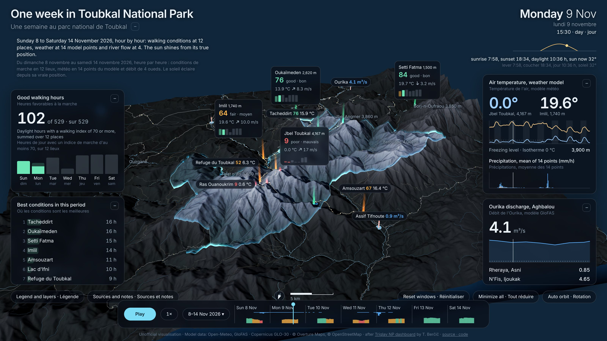

# One week in Toubkal National Park

An animated 3D view of Toubkal National Park (High Atlas, Morocco) that plays
a period hour by hour: walking conditions at 12 places, model weather at 14
points, modelled river flow at 4, snow on the ground, and the sun and its
shadows from their true position.

**▶ Dashboard: [`index.html`](index.html)**, served by GitHub Pages at
`/toubkal/`.



The idea and the layout follow
[One week in Triglav National Park](https://tomazbercic.github.io/tnp-dashboard/)
by Tomaž Berčič. The code here is written from scratch for Toubkal: a static
page (Three.js, no build step, no API keys) with a small Python pipeline for
the terrain and map layers.

## What differs from the Triglav original, and why

Triglav has visitor counters, a national network of weather stations and
river gauges, and a public transport timetable, all open. Toubkal has none
of these in the open, so **nothing on this page is a field measurement**:

| Triglav original | Here |
|---|---|
| Passages at 12 visitor counters | A **walking index** (0 to 100) at 12 places, worked out from the weather model. "Good walking hours" replace counted passages. |
| 9 ARSO weather stations | 14 points of the [Open-Meteo](https://open-meteo.com) forecast archive, each corrected to the height of the point |
| 10 ARSO river gauges | 4 points of GloFAS (Copernicus flood model) through the Open-Meteo Flood API |
| Buses and trains by timetable | None exist to draw. Cars on the main roads are an illustration. |
| Daily data refresh job | Not needed: the browser reads the live feeds when the page opens |

Added for Toubkal: snow laid on the terrain from the model's snow depth, the
freezing level, a forecast period ("next 7 days"), and wind taken at summit
height for the 4,000 m peaks.

## Walking index

For every hour and place: `100 × wind × cold × rain × cloud`.

| Factor | Counts in full | Falls to nothing |
|---|---|---|
| Wind | up to 5 m/s | at 20 m/s |
| Felt temperature (wind chill) | −5 to 28 °C | at −25 °C and at 40 °C |
| Precipitation | none | at 4 mm/h |
| Cloud cover | clear sky | full cloud takes off a quarter |

An hour is *good* when it is daylight and the index is 70 or more, *fair*
from 40. The thresholds sit in `walkIndex()` and `GOOD` / `FAIR` at the top
of `app.js`.

The index is a screening figure from a weather model. It knows nothing of
snow and ice underfoot, avalanche, rockfall or river crossings. **It is not
a mountain forecast and not safety advice.** For decisions, ask the Bureau
des Guides in Imlil and follow the Direction Générale de la Météorologie.

## Limits worth knowing

- The weather model's grid is several kilometres wide. The Toubkal refuge,
  the summit, Tizi n'Ouanoums and Ras Ouanoukrim fall in the same cell: they
  share rain and wind and differ only in temperature.
- Wind is the 10 m wind in the valleys, the 700 hPa wind (about 3,100 m) at
  Tizi n'Tacheddirt and the 600 hPa wind (about 4,300 m) on Toubkal,
  Ouanoukrim and Tizi n'Ouanoums. These are free-air winds, not what a ridge
  does to them.
- The model's terrain is lower than the real summits, so its snow depth
  under-reads the high ground. Rain is drawn as snow where the corrected
  temperature is 1 °C or less.
- GloFAS runs on cells of about 5 km. On catchments this small it follows
  the rise and fall of a river; its absolute discharge is rough. The cells
  were picked by hand as the neighbour that carries each river (see
  `GAUGES` in `pipeline/01_build_scene.py`).
- Hikers, cars and sparks are drawn, not counted.
- Times are Morocco standard time, UTC+1. During Ramadan the country's
  clocks go back an hour and the page does not follow.

## Files

| File | What it is |
|---|---|
| `index.html`, `style.css`, `app.js` | the page |
| `data/scene.json` | park boundary, roads, paths, walking routes, rivers, lakes, lifts, peaks, the named points |
| `data/dem.png` | elevation grid, 591 × 487 cells of 100 m, 16 bit in the R and G channels |
| `data/albedo.jpg` | relief texture |
| `data/snapshot.json` | one saved week of the live feeds, shown only if Open-Meteo cannot be reached |
| `pipeline/01_build_scene.py` | builds `scene.json`, `dem.png`, `albedo.jpg` |
| `pipeline/02_snapshot.py` | refreshes `snapshot.json` |
| `../vendor/three/` | Three.js 0.170 (MIT), vendored |

## Choosing a period

The page opens on the last 7 full days. The picker on the timeline offers
14 and 30 days, the next 7 days of forecast, or any range of up to 31 days
between 88 days back and 7 days ahead. The choice lives in the address:
`#from=2026-11-01&to=2026-11-14`.

## Rebuilding the static layers

```bash
pip install -r toubkal/pipeline/requirements.txt
python toubkal/pipeline/01_build_scene.py    # DEM + Overture -> data/
python toubkal/pipeline/02_snapshot.py       # optional: refresh the fallback week
python -m http.server                        # then http://localhost:8000/toubkal/
```

`01` downloads four Copernicus GLO-30 tiles (about 150 MB, cached in
`pipeline/.cache/`) and reads Overture GeoParquet straight from S3
(anonymous). Set `OVERTURE_RELEASE` if the pinned release has been retired.
To change the places the page reports on, edit `POINTS`, `ROUTES` and
`GAUGES` at the top of the script and run it again; the page takes
everything from `scene.json`.

## Credits

Idea and layout: Tomaž Berčič,
[One week in Triglav National Park](https://github.com/tomazbercic/tnp-dashboard).
Elevation: Copernicus DEM GLO-30 © DLR e.V. 2010–2014 and © Airbus Defence
and Space GmbH 2014–2018, provided under COPERNICUS by the European Union
and ESA. Park boundary, roads, paths, rivers, peaks: © Overture Maps
Foundation and OpenStreetMap contributors. Weather and discharge:
[Open-Meteo](https://open-meteo.com) (CC BY 4.0), GloFAS / Copernicus
Emergency Management Service. 3D engine: [Three.js](https://threejs.org)
(MIT).

Independent visualisation; not an official product of the Agence Nationale
des Eaux et Forêts, the park, the DGM or the Tensift basin agency.
